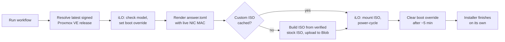

<p align="center">
  
</p>

<p align="center">
  <a href="https://github.com/benschwarz1982/proxmox-fleet-provisioning/actions/workflows/ci.yml"></a>
  <a href="LICENSE"></a>
  
  
</p>

# proxmox-fleet-provisioning

Unattended [Proxmox VE](https://www.proxmox.com/en/proxmox-virtual-environment)
installation for a fleet of identical HPE ProLiant DL160 Gen10 servers - driven entirely
through the iLO Redfish API, started from GitHub Actions (or GitLab CI).

One pipeline run reinstalls one server: it builds a per-host auto-install ISO
from the latest signed Proxmox VE release, mounts it as iLO virtual media and
reboots the host into a fully unattended installation.

## Contents

- [Features](#features)
- [How it works](#how-it-works)
- [Requirements](#requirements)
- [Quick start](#quick-start)
- [Configuration](#configuration)
- [Usage](#usage)
- [Operations](#operations)
- [Security](#security)
- [Design notes](#design-notes)
- [Limitations](#limitations)
- [Development](#development)
- [License](#license)

## Features

- **Zero-touch install** - hostname, static IP, disk and NIC selection come
  from an [automated-install answer file](https://pve.proxmox.com/wiki/Automated_Installation);
  the NIC's MAC is discovered live via Redfish on every run.
- **Always the latest release** - picks the newest Proxmox VE 9 ISO from
  Proxmox's GPG-signed `SHA256SUMS` and verifies the download against it.
- **Fast repeat runs** - per-host ISOs are content-addressed and cached on
  Azure Blob Storage; an unchanged config skips download and rebuild.
- **Safe by default** - hardware model check, blocked iLO ports, no
  plaintext root password in the ISO, no secrets or infrastructure details
  in the repository or in public logs.
- **Minimal footprint** - one stdlib-only Python script plus a slim
  container image; no Azure CLI, no extra Python packages at runtime.

## How it works



1. **Release** - fetch `SHA256SUMS` + `SHA256SUMS.asc` from
   `enterprise.proxmox.com`, verify the signature with the Proxmox release
   key and pick the newest `proxmox-ve_9.x-y.iso` (fallback: the last known
   release built into `provision.py`).
2. **Prepare the server** - verify the hardware model, set a persistent
   boot override to the virtual CD and move stale disk boot entries to the
   end of the boot order.
3. **Answer file** - render `answer.toml.template` with the run's values,
   the live NIC MAC and a SHA-512-crypt hash of the root password.
4. **Custom ISO** - reuse `<hostname>-pve<release>-<hash>.iso` from Azure
   Blob if it exists; otherwise take the stock ISO (from the Blob mirror,
   else from Proxmox), verify its SHA-256, embed the answer file with
   `proxmox-auto-install-assistant` and upload the result.
5. **Install** - mount the ISO via Redfish virtual media and power-cycle the
   host. After ~5 minutes the job clears the boot override and ends; the
   installation completes on the host by itself (~15-25 minutes).

## Requirements

| Component | Requirement |
|---|---|
| Servers | HPE ProLiant DL160 Gen10 with iLO 5 (the model is checked before any change), Redfish reachable over HTTPS from the runner, identical system disk model across the fleet |
| iLO account | Privileges for virtual media, power control and boot settings |
| Azure Storage | A storage account with a container (default `iso`) that allows **anonymous read of blobs** (iLO mounts the ISO by URL), plus a container SAS token with **create + write** only |
| CI | GitHub Actions (primary) or GitLab CI (alternative); hosted runners are fine |

## Quick start

1. **Azure** - create the storage account and the `iso` container
   (anonymous blob read), then generate a create+write SAS token:
   ```sh
   az storage container generate-sas --account-name <account> --name iso \
     --permissions cw --expiry <yyyy-mm-dd> --account-key <key> -o tsv
   ```
2. **GitHub environment** - **Settings → Environments → New environment
   `pve-fleet`**, restrict **Deployment branches** to `main`, optionally add
   **Required reviewers**.
3. **Settings** - add the [required settings](#required-fleet-wide) to
   `pve-fleet`.
4. **Deploy** - **Actions → Deploy Proxmox VE → Run workflow**, enter
   hostname, IP and iLO URL, approve the deployment.
5. **Finish** - after ~20 minutes log in at `https://<ip>:8006` as `root`,
   then eject the virtual media in iLO (**Virtual Media → Eject**).

## Configuration

All settings are environment variables with the same names in both
pipelines. Nothing environment-specific is committed - the examples below
are placeholders.

### Per run

Entered when starting a deployment.

| Variable | Example | Description |
|---|---|---|
| `PVE_HOSTNAME` | `pve-node15` | Host name; the FQDN becomes `<PVE_HOSTNAME>.<PVE_DOMAIN>` |
| `PVE_STATIC_IP` | `192.0.2.35/24` | Static IP in CIDR notation |
| `ILO_URL` | `https://ilo.example.com:4415` | iLO base URL, `https://` required |
| `PVE_NIC_INDEX` | `1` | Optional: Redfish `EthernetInterfaces` index of the cabled NIC |

### Required (fleet-wide)

| Variable | Secret | Example / description |
|---|---|---|
| `ILO_USER` | optional | `ilo-admin` |
| `ILO_PASSWORD` | **yes** | Password of `ILO_USER` |
| `PVE_ROOT_PASSWORD` | **yes** | Proxmox root password, 8-256 bytes; only its hash ends up in the ISO |
| `PVE_GATEWAY` | optional | `192.0.2.1` |
| `PVE_DNS` | optional | `198.51.100.10` (one resolver) |
| `PVE_DOMAIN` | optional | `example.internal` |
| `PVE_MAILTO` | optional | `admin@example.internal` |
| `AZURE_STORAGE_ACCOUNT` | optional | Storage account name |
| `AZURE_SAS_TOKEN` | **yes** | Container SAS token, create + write only |

*optional*: may be a plain variable; storing it as a secret keeps it masked
in public logs.

### Optional

| Variable | Default | Description |
|---|---|---|
| `ILO_BLOCKED_PORTS` | *(none)* | Comma-separated iLO ports that must never be reinstalled, e.g. `4411` - strongly recommended if non-Proxmox systems share the iLO host |
| `PROXMOX_MAJOR` | `9` | Proxmox VE major version to track |
| `PROXMOX_ISO_NAME` + `PROXMOX_ISO_SHA256` | *(latest)* | Pin a release, e.g. `proxmox-ve_9.3-1.iso` + its SHA-256; set both or neither |
| `PROXMOX_ISO_BASE_URL` | `https://enterprise.proxmox.com/iso/` | Source of `SHA256SUMS` and ISOs |
| `PROXMOX_KEYRING` | `/usr/share/keyrings/proxmox-release-trixie.gpg` | Key used to verify `SHA256SUMS` |
| `AZURE_CONTAINER` | `iso` | Blob container |
| `PVE_DISK_MODEL` | `Samsung SSD 870 QVO 1TB` | Target disk model (udev `ID_MODEL`, spaces allowed) |
| `PVE_TIMEZONE` | `Europe/Zurich` | Time zone |
| `PVE_KEYBOARD` | `de-ch` | Keyboard layout |
| `PVE_COUNTRY` | `ch` | Country code |

## Usage

### GitHub Actions

| Workflow | Trigger | Jobs |
|---|---|---|
| `ci.yml` | push to `main`, pull requests | `lint` (ruff), `test` (pytest), `build-image` |
| `deploy-pve.yml` | manual (**Run workflow**) | `deploy` in environment `pve-fleet` |

- Start one run per server. Runs against different servers can run in
  parallel; runs against the same iLO URL are queued.
- The container image is built inside the job (with the GitHub Actions
  cache); no registry is involved.
- A green job means the installation was handed off to the server, not that
  it finished - check the web UI or the iLO Remote Console afterwards.

### GitLab CI (alternative)

`.gitlab-ci.yml` provides the same flow: `validate` (`validate:lint`,
`validate:test` with code-quality and JUnit reports) → `build` (pushes the
image to the project registry when the `Dockerfile` changes) → `deploy`.

1. **Settings → CI/CD → Variables** - add the fleet-wide settings; secrets
   as **masked + protected**.
2. **CI/CD → Pipelines → Run pipeline** - fill in the three per-run fields
   (they default to harmless placeholders), then start the manual
   `deploy:pve` job.

## Operations

**New Proxmox releases** are picked up automatically within the configured
major version. The stock ISO is mirrored to the Blob container under its
original name (e.g. `proxmox-ve_9.3-1.iso`). Proxmox throttles downloads
from cloud IP ranges, so if a hosted runner can't fetch a new release, seed
the mirror once from another network after checking the file against
`SHA256SUMS`:

```sh
az storage blob upload --account-name <account> --container-name iso \
  --name proxmox-ve_<version>.iso --file proxmox-ve_<version>.iso --account-key <key>
```

If even `SHA256SUMS` can't be fetched, runs fall back to
`FALLBACK_ISO_NAME`/`FALLBACK_ISO_SHA256` in `provision.py`; bump both
together to move the fallback. A new **major** version (e.g. 10) requires
updating `PROXMOX_MAJOR`, the `Dockerfile` (Debian/Proxmox repository) and
the fallback together.

**Cleanup** - every config change or release produces a new custom ISO;
old ones (and old stock ISOs) are not deleted automatically. Remove them
from the container occasionally.

**SAS token** - the token expires; regenerate it before then (see
[Quick start](#quick-start)) and update the secret. The account key is only
needed for that command and is never stored in the pipeline.

## Security

- **No secrets in the image or repository** - all settings come from CI
  secrets/variables.
- **Root password** is stored in the ISO only as a SHA-512-crypt hash
  (`root-password-hashed`), salted per host.
- **Least-privilege storage access** - the pipeline only holds a
  create+write SAS token for one container.
- **Verified downloads** - `SHA256SUMS` must carry a valid signature from
  the Proxmox release key; every ISO is checked against it.
- **Guard rails** - `https://` is enforced for iLO and Proxmox URLs, the
  hardware model is checked before anything is changed, and
  `ILO_BLOCKED_PORTS` protects non-Proxmox systems.
- **Public logs** - the deploy job masks hostname, IP and iLO host, and the
  anonymous ISO URL is never logged.
- **Supply chain** - actions and base images are pinned by commit SHA /
  digest, workflows run with `contents: read`, and the Proxmox key is
  fetched with a pinned checksum.
- **Deployment control** - the `pve-fleet` environment only accepts `main`
  and can require an approval before every reinstall.

## Design notes

**Disk selection by model.** The answer file selects the target disk by
udev `ID_MODEL` (`PVE_DISK_MODEL`; spaces become underscores, as udev
reports them) instead of the serial number. This avoids waiting for iLO's
drive inventory, which is only populated a while after power-on.

**Persistent boot override.** A server may still carry a previous
installation whose UEFI entry comes first in the boot order. The script
therefore sets `BootSourceOverrideEnabled=Continuous` to `Cd` before any
reboot and verifies it twice.

**Disk entries moved last.** If the virtual media isn't ready in time, the
firmware can silently fall back to the boot order and start the old system.
All entries whose `UefiDevicePath` starts with `HD(` are moved to the end,
so a failed override falls through to USB/PXE instead. Redfish can't delete
boot entries, hence reordering. The new installation's entry is added at
the front by the firmware.

**Override cleared early.** The installer reboots into the new system
partway through. Since `Continuous` applies to every boot, the override is
cleared after ~5 minutes - after the installer has started, long before it
finishes - retrying while iLO reports `UnableToModifyDuringSystemPOST`.

**No completion check.** Hosted runners can't reach port 8006 of the
servers, so the job ends after the handoff instead of polling the web UI.
The ISO stays mounted because the running installer still reads from it.

## Limitations

- The disk filter matches every disk of that model - fine for servers with
  exactly one system disk; otherwise use a more specific filter (e.g.
  `ID_SERIAL_SHORT`) in `answer.toml.template`.
- Only one DNS resolver can be set in `answer.toml`.
- The virtual media has to be ejected manually after the installation (or
  by the next run); a later fallback boot from it would reinstall.
- The job does not report whether the installation succeeded.

## Development

```sh
python3.15 -m venv .venv && . .venv/bin/activate
pip install -r requirements-dev.txt
ruff check . && ruff format --check .
pytest
```

| Path | Purpose |
|---|---|
| `provision.py` | The provisioning script (stdlib only) |
| `answer.toml.template` | Proxmox auto-install answer file template |
| `Dockerfile` | CI image: `python:3.15-slim-trixie` + `gpgv`, `openssl`, `xorriso`, `proxmox-auto-install-assistant` |
| `tests/` | Unit tests: release selection, signature check (throwaway GPG keys), config validation, password hashing, ISO naming |
| `pyproject.toml`, `requirements-dev.txt` | ruff/pytest settings and pinned tool versions |

Tests that need `gpg`, `gpgv` or `openssl` are skipped locally if a tool is
missing, but always run in CI.

## License

[MIT](LICENSE)
